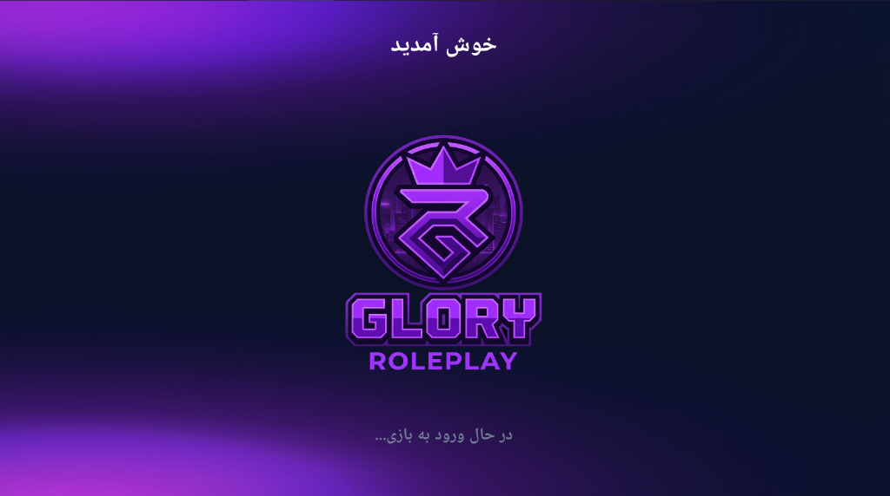
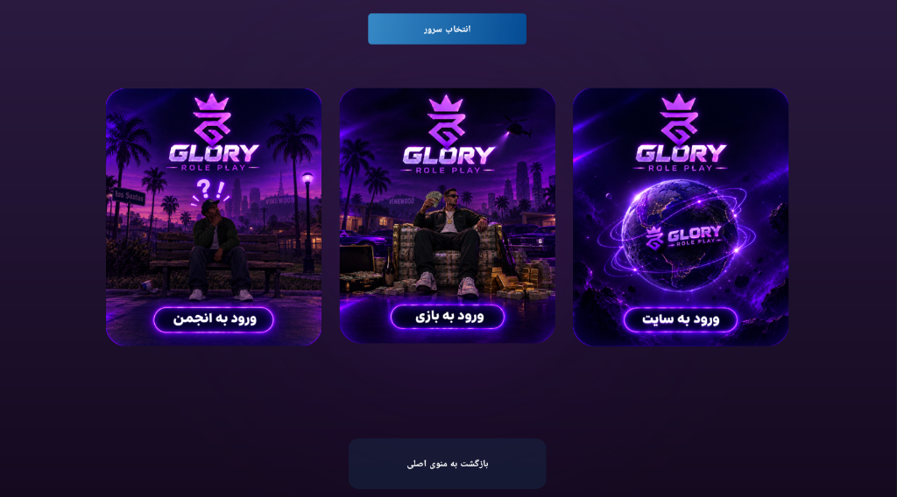
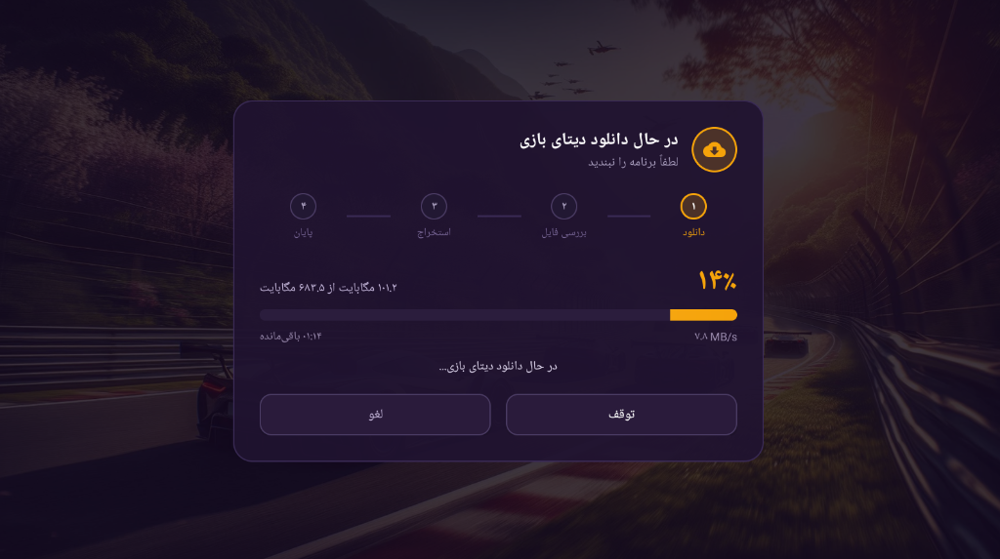
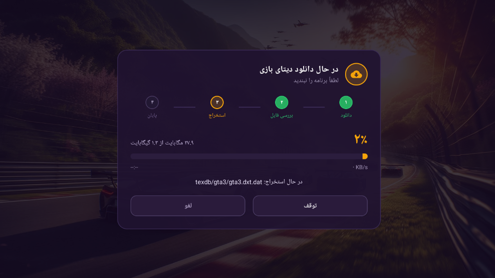
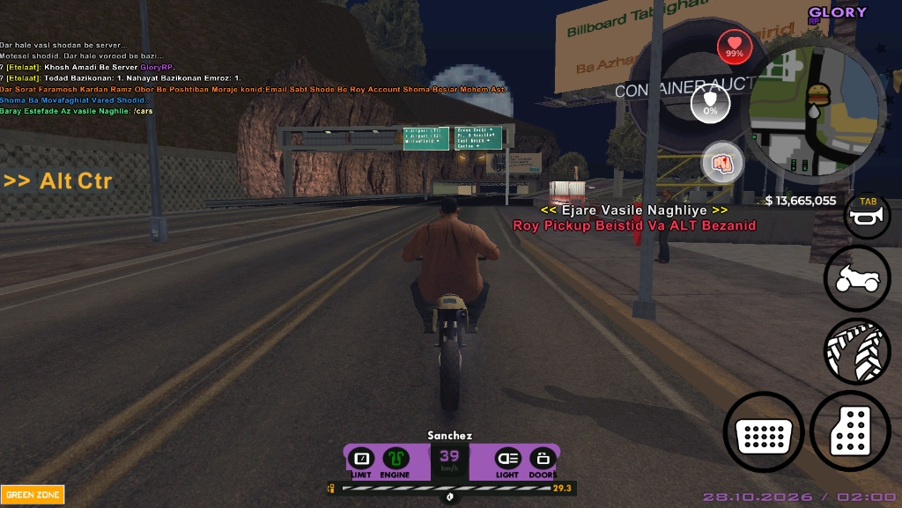

# SA-MP Android Dual-Architecture Client (ARM32 & ARM64)

[](LICENSE)
[](https://github.com/vinterely/samp-android-launcher-32-64bit/releases/latest)
[-orange.svg)](https://github.com/vinterely/samp-android-launcher-32-64bit)

A high-performance, modular **San Andreas Multiplayer (SA-MP)** mobile client and launcher for Android. This client provides full native support for both 32-bit (`armeabi-v7a`) and 64-bit (`arm64-v8a`) architectures, built on modern Android toolchains with C++17 native game engine hooks, Dear ImGui onscreen interface, and voice chat integration.

---

## Direct Download (Pre-built APK)

For users who want to try the client without setting up a full Android compilation environment:
- **Download Latest APK:** [**GitHub Releases (mobile-game-release.apk)**](https://github.com/vinterely/samp-android-launcher-32-64bit/releases/latest)
- **Build Type:** Release (Optimized, ProGuard/R8 applied, dual ARM32 & ARM64 native binaries included).
- **Game Data:** As standard with SA-MP mobile clients, clean GTA:SA game assets (textures, audio, data) must be provided in the storage directory or downloaded via the launcher.

---

## Tested Devices & Hardware Verification

The client has been verified on both 32-bit and 64-bit Android environments across the following physical test devices:

| Device | Android Version | OS / Skin | Architecture Verified | Status |
| :--- | :--- | :--- | :--- | :--- |
| **Xiaomi Redmi Note 13** | Android 13 / 14 | Xiaomi HyperOS | ARM64 (`arm64-v8a`) | **Passed** |
| **Xiaomi Redmi 14C** | Android 14 | Xiaomi HyperOS | ARM64 (`arm64-v8a`) | **Passed** |
| **Samsung Galaxy A56** | Android 14 / 15 | One UI | ARM64 (`arm64-v8a`) | **Passed** |
| **Xiaomi Redmi 14** | Android 14 | Xiaomi HyperOS | ARM64 (`arm64-v8a`) | **Passed** |
| **Legacy 32-bit Devices / VMs** | Android 9 - 11 | AOSP / Custom | ARM32 (`armeabi-v7a`) | **Passed** |

### Verified Features:
- Dual-architecture native loading (`armeabi-v7a` and `arm64-v8a`).
- Dual HUD switching between Classic (ImGui buttons + native radar) and Modern circular HUD.
- Voice chat low-latency streaming (Opus codec).
- On-screen touch input handling and key menus.

---

## Screenshots & Interface

<p align="center">
  
  
</p>
<p align="center">
  
  
</p>
<p align="center">
  
  
</p>

---

## Key Features

- **Dual-Architecture Support:** Compiles seamlessly for both `armeabi-v7a` (32-bit) and `arm64-v8a` (64-bit).
- **Dual HUD Architecture:**
  - **Classic HUD:** Uses the native GTA:SA radar and HUD (`pGame->DisplayHUD(true)`), with radar placed at top-left (`50.0f, 70.0f`) and on-screen controls rendered via Dear ImGui (`>>`, `Alt`, `G`, `L. Ctrl`, and expandable action menu `Tab`, `Y`, `N`, `H`).
  - **Modern Custom HUD:** Fully customizable Android native layout with circular radar positioned at top-right and native square background removal patches.
- **Dynamic Render Pipeline:** Optimized RW (RenderWare) hooks, DN pipeline stability fixes, and texture rasterization.
- **Built-in Voice Chat:** Low-latency voice communication with Opus codec.
- **Embedded Launcher & Game Data Manager:** Clean, responsive activity workflow for asset checking and server connectivity.

---

## Prerequisites & Requirements

Before building the project from source, ensure your development environment meets the following specifications:

| Requirement | Minimum / Recommended Version |
| :--- | :--- |
| **Operating System** | Windows 10/11 or Linux (Ubuntu 20.04+) |
| **JDK** | JDK 17 (OpenJDK / Eclipse Temurin / Oracle JDK) |
| **Android SDK** | Android SDK Platform API 30+ (Build-Tools `30.0.3`+) |
| **Android NDK** | NDK `21.4.7075529` (r21e) |
| **CMake** | CMake `3.18.1` or higher |
| **Gradle** | Gradle Wrapper `7.x` (included in project) |

---

## Step-by-Step Compilation Guide

### Step 1: Clone the Repository
```bash
git clone https://github.com/vinterely/samp-android-launcher-32-64bit.git
cd samp-android-launcher-32-64bit
```

### Step 2: Configure Environment Paths
Create a `local.properties` file in the root directory (you can copy `local.properties.example`):

**Windows example (`local.properties`):**
```properties
sdk.dir=C:/Users/<YourUsername>/AppData/Local/Android/Sdk
ndk.dir=C:/Android/Sdk/ndk/21.4.7075529
```

**Linux / macOS example (`local.properties`):**
```properties
sdk.dir=/home/<yourusername>/Android/Sdk
ndk.dir=/home/<yourusername>/Android/Sdk/ndk/21.4.7075529
```

### Step 3: Configure Release Signing (Optional)
By default, the build configuration accepts signing credentials via `gradle.properties` or environment variables without exposing sensitive keystore credentials in the source code.

To sign your release build with your custom keystore, add the following to `gradle.properties` (or set them as environment variables):
```properties
RELEASE_STORE_FILE=C:/path/to/your_keystore.jks
RELEASE_STORE_PASSWORD=your_store_password
RELEASE_KEY_ALIAS=your_key_alias
RELEASE_KEY_PASSWORD=your_key_password
```
*Note: If no keystore is specified, the build completes successfully and produces an unsigned or debug-signed artifact.*

### Step 4: Build the Release APK
Run the Gradle assembly command from your terminal:

**On Windows:**
```cmd
cmd.exe /c gradlew.bat assembleVer_releaseRelease
```
*Or using PowerShell:*
```powershell
.\gradlew.bat assembleVer_releaseRelease
```

**On Linux / macOS:**
```bash
chmod +x gradlew
./gradlew assembleVer_releaseRelease
```

### Step 5: Locate the Output APK
Once the compilation succeeds, the output package will be available at:
```
app/build/outputs/apk/ver_release/release/mobile-game-release.apk
```

---

## Project Structure

```
├── app/
│   ├── build.gradle               # App-level build scripts & flavor configurations
│   ├── proguard-rules.pro         # ProGuard / R8 optimization rules
│   └── src/main/
│       ├── AndroidManifest.xml    # Android app manifest & permissions
│       ├── assets/                # Default game configurations (settings.ini, data files)
│       ├── cpp/                   # Native C++ Source Code
│       │   ├── multiplayer/       # Core client hooks, networking, RakNet & ImGui
│       │   └── CMakeLists.txt     # Native CMake build definition
│       ├── java/                  # Android launcher, UI widgets & JNI wrappers
│       └── res/                   # Layouts, vector drawables, themes and fonts
├── docs/screenshots/              # In-game and launcher interface screenshots
├── gradle/wrapper/                # Gradle wrapper configuration
├── build.gradle                   # Root build script
├── gradle.properties              # Project-wide JVM and Gradle parameters
├── local.properties.example       # Example SDK and NDK configuration template
├── LICENSE                        # Apache 2.0 Open Source License
└── README.md                      # Project documentation and build guide
```

---

## Configuration & HUD Modes

The client supports switching between two distinct HUD interfaces via settings or configuration:

1. **Classic HUD Mode:**
   - Native GTA:SA radar and status bars enabled.
   - On-screen touch buttons dynamically rendered through Dear ImGui (`UI::renderKeys()` in `gui.cpp`).
   - Radar placed at standard top-left position (`50.0f, 70.0f`).

2. **Modern HUD Mode:**
   - On-screen native touch controls and custom HUD elements rendered via Android XML views (`hud.xml` / `Hud.java`).
   - Radar repositioned to circular frame at top-right with square border patches active.

---

## Important Notice & Project Status

> [!IMPORTANT]
> **As-Is Initial & Final Release:**
> - This codebase is provided **"as-is"** for educational, modding, and gaming community purposes.
> - While functional and tested on physical devices (Redmi Note 13, Redmi 14C, Samsung A56, Redmi 14), please be aware that it may contain minor bugs or environment-dependent issues depending on device GPU drivers and Android OEM skins.
> - **No Ongoing Maintenance:** This project is complete and archived. No further updates, issue resolution, or feature developments are planned. This is the **initial and final** public release.

---

## License & Disclaimer

This project is licensed under the [Apache License, Version 2.0](LICENSE).  
Grand Theft Auto and SA-MP are trademarks of their respective owners. This project is not affiliated with Rockstar Games or Take-Two Interactive.
